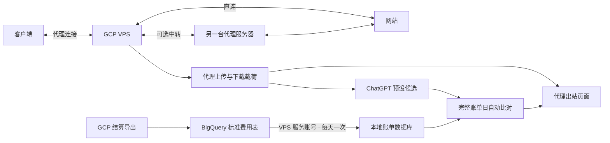

# 代理出站、Carrier Peering 分析与账单同步

适用：已安装本仓库版本的 GCE VPS，使用 systemd。以下 VPS 命令在 SSH 中执行；Google 控制台操作在浏览器中完成。

## 1. 更新并打开页面

在 VPS 进入 root：

```bash
sudo -i
SUI_LANG=zhcn bash <(curl -fsSL https://raw.githubusercontent.com/JamesAlaHZS/s-ui-gpc-optimize/main/install.sh)
```

已有面板保留数据库；安装器会短暂重启服务。完成后强制刷新浏览器，选择简体中文，进入 **出站流量**。



## 2. 看懂并配置出站总览

1. **代理出站载荷合计**：发往远端的上传载荷，加上发回客户端的下载载荷。两段都属于 VPS 向外转发，不会只统计上传。
2. **代理入站载荷合计**：按同一批已转发载荷计算，为从客户端收到的上传加上从远端收到的下载。与出站合计是转发内容的两侧镜像，通常相等，不是两次独立收发实测；不能把两项相加当成计费用量。
3. **代理目标排行**：显示域名、对端、远端上传和下载，按两段出站载荷合计排序，最多 500 项。网卡、内核连接统计移入诊断，不作为代理业务主指标。
4. 默认看最近 24 小时。填写开始、结束日期可查区间，包含结束当天，最长 3 个日历年；查一天时两项填同一天。对照 GCP 账单时选 **洛杉矶时间**，页面会按夏令时计算日期边界。各标签页使用同一查询区间。
5. 代理总量和 ChatGPT / 其他 / 未知三组小时汇总最长保留 3 年；逐对端明细保留 7 天，最多 100,000 行。升级只迁移尚存的历史数据，不能恢复已清理的数据，也不会把旧日有连接记录当成整日采集完整。

### ChatGPT 候选如何分析

默认观察 `chatgpt.com`、`openai.com`、`oaistatic.com`、`oaiusercontent.com` 及其子域名。域名按完整后缀边界匹配，不将共享 IP 自动归为 ChatGPT。候选显示远端上传、远端下载和两段出站载荷合计，**这些是待验证的业务载荷，不是 Google 已确认的 Carrier Peering 用量**。

程序在每次读取时用最新本地数据自动重算：

单日或最近 24 小时等短查询会自动向前回看 35 个洛杉矶自然日，页面单列“自动对账窗口”；主统计仍严格使用所选日期，不会混入此前流量。历史查询的自动对账不会读取所选截止时间之后的数据。

1. 按洛杉矶账单日汇总 ChatGPT、其他和未知代理载荷；独立心跳确认无连接时段也在正常观察。
2. 对齐已导入的 `Network Data Transfer Out via Carrier Peering Network - Americas Based` 用量与净费用；项目、币种分别处理。
3. 排除近期等待导出的日期、缺少账单或代理覆盖不完整的日期。缺少该 SKU 行不冒充实际零费用。
4. 至少积累 7 个完整可比账单日，再比较候选与费用用量的变化，同时检查其他流量是否同步变化。数据不足、流量不变、未知域名过多或混杂时，明确显示等待或无法区分。

新数据或迟到账单到达后，结果会自动更新；不会自动改路由、扩充收费域名黑名单或分摊单网站金额。域名不可见和 UDP 多目标复用保留未知。没有代理观测显示“—”，不会显示成真实零。

### 能否查出额外流量费

主页突出上述 Carrier Peering SKU 的真实账单用量与净费用，并单独显示 ChatGPT 候选载荷。**自动分析提供排查优先级和相关性，不是 Google 的逐连接收费凭证。** 同项目其他资源仍可能贡献账单；代理载荷不含完整网络开销。账单页继续保留五项费用明细，未同步或延迟不等于零费用。

如果未采集或长时间没有更新：

```bash
systemctl status traffic-review-collector --no-pager
journalctl -u traffic-review-collector -n 40 --no-pager
tail -n 40 /var/lib/s-ui-traffic-review/collector.err
ip -4 route show default
```

默认自动识别公网网卡。多网卡或检测错误时，把 `ens4` 换成实际公网接口：

```bash
SUI_TRAFFIC_REVIEW_INTERFACE=ens4 bash /usr/local/s-ui/deploy/setup-traffic-review.sh
```

这会开启连接字节记账并重启采集器。已有连接可能需要重新连接后才有完整字节计数。无需在网页填写网卡名。

## 3. 同步 GCP 账单

账单链路：**GCP 结算 → BigQuery 标准使用费用表 → VPS 服务账号查询 → 本地数据库 → 页面**。网页刷新只读本地数据库，定时器每天查询一次；Google 导出没有保证固定的每日到达时间。以下示例均为占位值，请替换后再使用。

需要准备：有权修改结算导出的 Google 账号、管理查询项目和数据集权限的账号，以及 VPS 的 root 权限。这些可以是同一个 Google 账号；VPS 查询实际使用的是虚拟机的服务账号。

### 第一步：获取 VPS 身份

VPS 执行：

```bash
bash /usr/local/s-ui/deploy/configure-billing.sh --info
```

记录 **VPS 项目 ID** 和 **服务账号邮箱**。服务账号可能形如 `123456789012-compute@developer.gserviceaccount.com`，也可能是自建账号；以命令输出为准。不是你的 Google 登录邮箱；不需要下载 JSON 密钥。

输出应包含 `https://www.googleapis.com/auth/cloud-platform`。如果没有：

1. Google 控制台 → **Compute Engine → 虚拟机实例** → 点击当前 VPS 名称。
2. 在“API 和身份管理”核对服务账号及“Cloud API 访问权限范围”。默认范围可能不允许 BigQuery；不能只凭已经授予 IAM 角色判断。
3. 点击顶部 **停止**，等待状态变为已停止，再点 **修改**。找到“访问权限范围”，选择 **允许全面访问所有 Cloud API**，保存并启动实例。
4. SSH 重新连接后，再运行 `--info`，确认出现上述 `cloud-platform` 地址。此项只设置访问范围，实际权限仍由 IAM 角色限制。停机会中断代理；使用临时外部 IP 时需重新核对地址。

如果没有关联服务账号，先创建专用服务账号，再在该处关联。普通非 GCE VPS 不能使用本程序的 VM 元数据认证方式。

依据：[Google 服务账号与访问范围](https://docs.cloud.google.com/compute/docs/access/service-accounts)、[修改实例服务账号](https://docs.cloud.google.com/compute/docs/instances/change-service-account)。

### 第二步：开启标准费用导出

1. Google 控制台 → **结算** → 选择 VPS 所属结算账号。
2. **结算导出 → BigQuery 导出 → 标准使用费用（Standard usage cost）**，点击启用或编辑设置。
3. 选择保存账单的项目。该项目需启用结算，并关联同一结算账号；可直接用 VPS 项目。
4. 没有数据集时，创建数据集：ID 填 `billing_export`，位置类型选 **多区域**，位置选 **US**；其他选项保持默认。
5. 选中数据集并保存，确认“标准使用费用”显示已启用。本工具只读取标准表，无需为它开启详细使用费用、价格或 FOCUS 导出；已有其他用途的导出可保留。
6. 打开 **BigQuery → Explorer / 资源管理器 → 保存账单的项目 → billing_export**，等待自动出现表：`gcp_billing_export_v1_……`。不要手工创建空表冒充账单表。

**US 多区域与 us-west1 单区域不同**：首次启用时，US/EU 多区域支持从上月月初回填；`us-west1` 等支持的单区域仅导出启用当日起的数据。已建数据集不能直接修改位置，切换导出数据集也不会自动搬入旧表历史。按历史需求选位置，不以 VPS 同区作为最低费用保证。[官方位置与回填规则](https://docs.cloud.google.com/billing/docs/how-to/export-data-bigquery-setup)

首次出现数据可能要几小时；历史回填按时间先后进行，追上当前用量可能需 5 天。Google 不保证固定延迟，也没有“最长 24 小时一定有表”的承诺。刚启用没有表时先核对设置并等待。[官方数据延迟说明](https://docs.cloud.google.com/billing/docs/how-to/export-data-bigquery-tables)

### 第三步：给 VPS 服务账号授权

使用有权限的 Google 管理账号在控制台操作：

1. 顶部切换到 **查询项目**（通常用 VPS 项目）：**API 和服务 → 库 → 搜索 BigQuery API**，确认已启用。
2. **IAM 和管理 → IAM → 授予访问权限**。
3. 新主账号填第一步的 **VPS 服务账号邮箱**，添加 **BigQuery 作业用户**（`roles/bigquery.jobUser`），保存。
4. **BigQuery → 账单所在项目 → 选中 billing_export 数据集 → 共享 / 管理权限 → 添加主账号**。
5. 填同一个服务账号邮箱，添加 **BigQuery 数据查看者**（`roles/bigquery.dataViewer`），保存。权限授予该数据集即可。

前者允许在查询项目提交作业，后者允许读取账单数据集。跨项目时两处都要核对。已有等效权限可复用；不需要为此新增 Editor（编辑者）等宽泛角色，也不要随意移除其他工作负载正在使用的权限。[BigQuery IAM 官方说明](https://docs.cloud.google.com/bigquery/docs/control-access-to-resources-iam)

### 第四步：确认表名并填写向导

在 BigQuery 中点击自动生成的标准表，打开“详情”，复制 **表 ID**，例如：

```text
your-dataset-project-id.billing_export.gcp_billing_export_v1_012345_ABCDEF_678901
└ 数据集所在项目 ID      └ 数据集 ID    └ 表名（这一段全部复制）
```

如果表还没有出现，可在 **结算 → 账号管理** 读取结算账号 ID，例如 `012345-ABCDEF-678901`。标准表名通常是固定前缀加上将连字符改成下划线的账号 ID：`gcp_billing_export_v1_012345_ABCDEF_678901`。这只用于核对预期名称；**推导正确不代表表已创建**，以资源管理器中的实际表和向导预检为准。[官方账单表结构](https://docs.cloud.google.com/billing/docs/how-to/export-data-bigquery-tables)

VPS 执行：

```bash
sudo bash /usr/local/s-ui/deploy/configure-billing.sh
```

按下面对应填写，示例值请换成你的：

| 向导提示 | 配置项 | 去哪里找 / 填什么 | 占位示例 |
|---|---|---|---|
| 查询项目 ID | `GCP_QUERY_PROJECT` | 第三步已启用 API、已授予作业用户的项目 | `your-query-project-id` |
| 账单数据集所在项目 ID | `GCP_DATASET_PROJECT` | 表 ID 第一段，保存账单表的项目 | `your-dataset-project-id` |
| 账单数据集 ID | `GCP_BILLING_DATASET` | 表 ID 第二段 | `billing_export` |
| 完整表名 | `GCP_BILLING_TABLE` | 表 ID 第三段，含完整前缀，不含项目、数据集或反引号 | `gcp_billing_export_v1_012345_ABCDEF_678901` |
| 需要统计的 VPS 项目 ID | `GCP_TARGET_PROJECT` | 第一步 `--info` 输出的 VPS 项目 ID，用于筛选其费用 | `your-vm-project-id` |

三个项目字段可以相同：若查询、账单表、VPS 都在同一项目，均填该 **项目 ID**。项目 ID 不是显示名称、数字项目编号或结算账号 ID。提示中的默认值正确时按回车接受。

向导先空跑预检（dry-run，不实际执行查询），再同步最近 7 天。**两步都成功后**才写入 `/etc/s-ui/traffic-review-billing.env` 并启用定时器；失败时保留原配置和原定时器状态。向导自动识别同步服务用户并设置文件权限，不要把用户或组硬编码为 `sui-monitor`。不需要手工复制 systemd 文件，不需要运行 `gcloud auth application-default login`。

向导显示本次新增、修正和已有未变的记录数。三项均为 0 表示本次没有匹配账单，不代表已经导入，也不代表没有费用；检查源表、所选项目和日期。重新运行采集器安装脚本会显示账单定时器的实际运行与开机启用状态，不会关闭已有账单定时器。

预检失败按下方错误表处理，修正或等待表生成后再运行同一向导。`404` 不能证明 IAM 与认证已全部通过；不要把所有失败都当成“建表中”并无限重试。

### 第五步：确认同步成功

```bash
systemctl list-timers traffic-review-bill-sync.timer --all
systemctl status traffic-review-bill-sync.timer --no-pager
date '+%F %T %Z'
```

当前定时器按 **VPS 系统时区每天 00:15** 触发，附加最多 15 分钟随机延迟；停机错过的任务会在恢复后补跑。以 `list-timers` 的 NEXT 为准。这个时间与账单日期的洛杉矶时区是两回事；每天同步不代表 Google 保证每天完成导出。

面板 → 出站流量 → **GCP 账单** → 时区选 **洛杉矶时间** → 日期先选昨天；昨天还未导出就选前天。查看“最近导入”“最新导出”和五项明细。未导出或无记录显示“—”，不表示费用为零。页面每 10 秒刷新本地数据，不会每 10 秒查询 BigQuery。

后续手动立即同步：

```bash
sudo systemctl start traffic-review-bill-sync.service
sudo systemctl status traffic-review-bill-sync.service --no-pager
sudo tail -n 40 /var/lib/s-ui-traffic-review/bill-sync.err
```

服务执行成功后显示 `inactive (dead)` 是正常的，它是一次性任务；应检查退出码是否 `0/SUCCESS`，定时器是否 `active (waiting)`。日志文件会保留旧错误，结合最近执行时间判断。

### 第六步：排错与历史补齐

| 情况 | 处理 |
|---|---|
| `403` / `ACCESS_DENIED` | 核对授权对象是 VPS 服务账号；检查作业用户、数据集查看者、BigQuery API 和 BigQuery 或 cloud-platform 访问范围。权限生效后重跑向导。 |
| `404` / `Not found` | 核对项目、数据集、完整表名和报错中的位置；在 BigQuery 确认该表实际存在。刚启用时可等待后重跑；不能据此认定权限已全部正确。 |
| `dry_run_ok`，但尚无导入 | 只说明预检成功，不代表已经导入。用中文向导完成首次实际同步，或已有配置时手动启动同步服务。 |
| 元数据认证失败 | 确认这是 GCE 虚拟机、已关联服务账号，且网络可访问元数据服务。 |
| `maximum bytes` / `budget` | 当前每次扫描上限 64 MiB、本程序月累计上限 3.875 GiB；不会自动加预算。不要反复重试，应先缩小手动查询日期或检查账单表规模。 |
| 已导入但所选日期为空 | 查看最新导出时间；选择已导出的日期，时区用洛杉矶。首次自动同步只回看 7 天。 |
| 五项都是空，但原始明细有记录 | 当前仅跟踪指定的俄勒冈标准出站、跨区和运营商互联等五项；其他地区或其他计费项目查“已导入账单明细”及 GCP 原账单。 |

`404` 也可能表示请求位置与资源位置不匹配，需读完整错误，而不是只看状态码。[BigQuery 官方错误说明](https://docs.cloud.google.com/bigquery/docs/error-messages)

查询扫描上限仅约束本程序，不能限制其他 BigQuery 作业、存储或容量费用；不是账户消费封顶。免费额度受计费方式、资格和其他作业用量影响，不能保证本方案零费用。[BigQuery 价格说明](https://cloud.google.com/bigquery/pricing)

需要首次补齐最近 31 天时，在已有配置并且预检预算允许的情况下执行一次：

```bash
sudo -i
set -a
. /etc/s-ui/traffic-review-billing.env
set +a
monitor=$(systemctl show traffic-review-bill-sync.service -p User --value)
[[ -n "$monitor" && "$monitor" != root ]] || { echo '同步服务用户异常，先重新配置采集器'; exit 1; }
args=(sync-bill --db /var/lib/s-ui-traffic-review/review.db
  --query-project "$GCP_QUERY_PROJECT" --dataset-project "$GCP_DATASET_PROJECT"
  --dataset "$GCP_BILLING_DATASET" --table "$GCP_BILLING_TABLE"
  --target-project "$GCP_TARGET_PROJECT" --lookback-days 31
  --max-bytes 67108864 --max-monthly-bytes 4160749568 --adc)
runuser -u "$monitor" -- /usr/local/bin/traffic-review "${args[@]}" --dry-run
```

仅在上述预检成功后继续：

```bash
runuser -u "$monitor" -- /usr/local/bin/traffic-review "${args[@]}"
```

不要给定时服务改成 31 天反复扫描。只有 Google 已导出的日期才可补齐；增加回看天数不能凭空恢复单区域启用前的数据。**不要把 `deploy/*example*` 样例导入生产数据库** `/var/lib/s-ui-traffic-review/review.db`；演示必须使用独立临时数据库。

账单按项目、日期和计费项目汇总，不能单独分离该项目里某台 VPS，更不能确认某条连接的费用。200 GiB 是整个结算账号共享的标准出站参考，页面不把项目用量当作账号真实余量。

## 4. 中转是什么，如何配置

中转是 **另一台已有可用代理服务的服务器**。例如你用 GCP VPS 接收客户端连接，再让部分网站经另一台服务器访问：

```text
客户端 ⇄ GCP VPS ⇄ 中转服务器 ⇄ 指定网站
客户端 ⇄ GCP VPS ⇄ 其他网站（原有路由）
```

没有第二台可用代理就暂时不用配置。`relay-out` 只是你为它取的出站标签，不会凭空创建服务器；它与 Google 的 Carrier Peering（运营商互联计费）不是同一个概念。

1. 准备中转服务器的真实 **协议、地址、端口、认证信息**。例如已有 SOCKS5 服务，必须确认从 GCP VPS 能访问它。
2. 面板 → **出站管理** → 添加 → 选择真实协议（上述示例选 SOCKS），标签填 `relay-out`，填写服务器地址、端口、用户名和密码等参数，保存。其他协议按节点实际参数填写 TLS 等选项。
3. 出站流量 → **中转配置** → 填写刚创建的标签和确实要中转的域名后缀（如 `example.com`），生成规则预览。
4. 面板 → **路由列表** → 添加规则：动作选择路由，出站选 `relay-out`，域名后缀填同样的域名。将规则放在可能提前匹配这些网站的宽泛规则之前。
5. 保存并 **应用更改**，重新建立测试连接；已有连接不会自动迁移。
6. 在面板实时连接中核对对应域名使用的出站是否为 `relay-out`。若只有 IP、没有可用于路由的域名，需要客户端传递域名，或按现有入站配置启用域名嗅探后再验证。

规则结构仅用于核对，不是整份配置：

```json
{"domain_suffix":["example.com"],"action":"route","outbound":"relay-out"}
```

本页不会自动修改路由。撤销时删除或禁用该规则，再应用更改；确认没有其他规则引用后再删除出站。

中转不保证便宜：GCP 发往中转的数据、以及 GCP 发回客户端的数据，仍是 VPS 出站。比较费用要等待前后两段日期的真实账单导出，不能凭直连、域名或 IP 归属判断标准出站或运营商互联。

## 5. SSL 证书域名

Cloudflare 证书的原有操作流程和认证方式保持不变：`s-ui` → **20**，可使用 API Token（Account ID 可留空）或 Global API Key + 邮箱，无需填写 Zone ID。

输入 `panel.example.com` 就只申请该域名；只有明确输入 `*.example.com` 才申请泛域名。脚本不会额外追加泛域名。修正旧证书时选择 **2. Force renew existing Certificates**，重新输入需要的域名。
