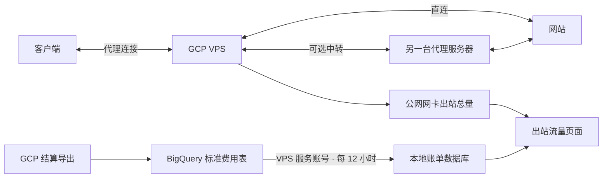

# 出站流量、GCP 账单与中转配置

适用：已安装本仓库版本的 GCE VPS，使用 systemd。以下 VPS 命令在 SSH 中执行；Google 控制台操作在浏览器中完成。

## 1. 更新并打开页面

在 VPS 进入 root：

```bash
sudo -i
SUI_LANG=zhcn bash <(curl -fsSL https://raw.githubusercontent.com/JamesAlaHZS/s-ui-gpc-optimize/main/install.sh)
```

已有面板保留数据库；安装器会短暂重启服务。完成后强制刷新浏览器，选择简体中文，进入 **出站流量**。



## 2. 看懂并配置出站总览

1. **VPS 出站总量**：公网网卡 TX，包括发往网站、中转，以及发回客户端的数据。看 VPS 发出了多少流量，先看这个数字。
2. **发往网站或远端 / 发回客户端**：内核连接记账的方向拆分，可能漏采。两者不保证等于网卡总量，不能再与网卡总量相加。远端也包括系统服务，并非全是代理网站。
3. **出站对端排行**：按内核记录的出站字节排序，最多 500 项；选择方向可只看远端或客户端。IP 不能自动确定网站或计费类别。
4. 默认看最近 24 小时。查某天，填写日期；对照 GCP 账单时选 **洛杉矶时间**。北京时间与账单日期的边界不同。
5. 代理上传、下载载荷放在“其他测量值”，不作为 VPS 出站总量。连接明细保留期有限，历史日期可能只剩网卡汇总；页面会提示不完整。

如果未采集或长时间没有更新：

```bash
systemctl status traffic-review-collector --no-pager
journalctl -u traffic-review-collector -n 40 --no-pager
tail -n 40 /var/lib/s-ui-traffic-review/collector.err
ip -4 route show default
```

默认自动识别公网网卡。多网卡或检测错误时，把 `ens4` 换成实际公网接口：

```bash
SUI_TRAFFIC_REVIEW_INTERFACE=ens4 bash /usr/local/s-ui/deploy/setup-traffic-review.sh
```

这会开启连接字节记账并重启采集器。已有连接可能需要重新连接后才有完整字节计数。无需在网页填写网卡名。

## 3. 同步 GCP 账单

这里的 GCP 指 Google Cloud。账单链路是 **GCP 结算 → BigQuery 标准费用导出 → VPS 本地数据库 → 页面**；网页刷新只读本地数据库。

### 第一步：获取 VPS 身份

VPS 执行：

```bash
bash /usr/local/s-ui/deploy/configure-billing.sh --info
```

记录 **VPS 项目 ID** 和 **服务账号邮箱**。不是你的 Google 登录邮箱；不要复制访问令牌，也不用下载 JSON 密钥。

输出应包含 `https://www.googleapis.com/auth/cloud-platform`。如果没有：

1. Google 控制台 → Compute Engine → 虚拟机实例 → 当前 VPS。
2. 先停止虚拟机，再编辑“服务账号 / 访问权限范围”；启用“允许全面访问所有 Cloud API”，保存并启动。
3. 此项只设置访问范围，实际权限仍由下面的 IAM 角色限制。停止实例会暂时中断代理；使用临时外部 IP 的实例重启后需核对 IP。

如果没有关联服务账号，先创建专用服务账号，再在该处关联。普通非 GCE VPS 不能使用本程序的 VM 元数据认证方式。

依据：[Google 服务账号与访问范围](https://docs.cloud.google.com/compute/docs/access/service-accounts)、[修改实例服务账号](https://docs.cloud.google.com/compute/docs/instances/change-service-account)。

### 第二步：开启标准费用导出

1. Google 控制台 → **结算** → 选择 VPS 所属结算账号。
2. **结算导出 → BigQuery 导出 → 标准使用费用**，点击编辑设置。
3. 选择保存账单的项目。该项目需启用结算，并关联同一结算账号；可直接用 VPS 项目。
4. 在 BigQuery 中创建数据集，例如 `billing_export`。新建时可选 `US` 多区域：首次启用支持历史回填；已有区域数据集可以继续使用，但不保证有启用前的历史账单。
5. 选中这个数据集并保存导出设置。只需要 **标准使用费用**，不需要开启详细费用、价格或 FOCUS 导出。
6. 打开 BigQuery → Explorer / 资源管理器 → 项目 → 数据集，等待自动出现表：`gcp_billing_export_v1_……`。

首次出现数据可能要几小时；初次历史回填可能持续 5 天。Google 不保证固定导出延迟。不要因为刚启用没有表就反复重建。[官方设置与延迟说明](https://docs.cloud.google.com/billing/docs/how-to/export-data-bigquery-setup)。

在表的“详情”复制表 ID，例如：

```text
example-vps.billing_export.gcp_billing_export_v1_012345_ABCDEF_678901
└ 项目 ID   └ 数据集 ID    └ 完整表名（这一段全部复制）
```

### 第三步：给 VPS 服务账号授权

使用有权限的 Google 管理账号在控制台操作：

1. 切换到 **运行查询的项目**（通常用 VPS 项目），确认启用了 **BigQuery API**：API 和服务 → 库 → 搜索 BigQuery API → 启用。
2. IAM 和管理 → IAM → 授予访问权限。
3. 新主账号填第一步的 **VPS 服务账号邮箱**，添加 **BigQuery 作业用户**（`roles/bigquery.jobUser`），保存。
4. BigQuery → 账单所在项目 → 选中 **账单数据集** → 共享 / 权限 → 添加主账号。
5. 填同一个服务账号邮箱，添加 **BigQuery 数据查看者**（`roles/bigquery.dataViewer`），保存。权限授予数据集即可。

这两个权限作用不同：前者允许发起查询，后者允许读取账单。跨项目导出时，不能只给 VPS 项目加权限就结束。[BigQuery IAM 官方说明](https://docs.cloud.google.com/bigquery/docs/control-access-to-resources-iam)。

### 第四步：在 VPS 运行中文向导

```bash
sudo bash /usr/local/s-ui/deploy/configure-billing.sh
```

按下面对应填写，示例值请换成你的：

| 提示 | 填什么 | 示例 |
|---|---|---|
| 查询项目 ID | 获得作业用户权限、启用 BigQuery API 的项目 | `example-vps` |
| 账单数据集所在项目 ID | 表 ID 第一段 | `example-vps` |
| 账单数据集 ID | 表 ID 第二段 | `billing_export` |
| 完整表名 | 表 ID 第三段，保留全部字符 | `gcp_billing_export_v1_012345_ABCDEF_678901` |
| 需要统计的 VPS 项目 ID | 产生 VPS 费用的项目 ID | `example-vps` |

前三个“项目”都填写 **项目 ID**，不是显示名称、数字项目编号、结算账号 ID。提示有默认值时按回车即可接受。

向导先执行预检，再同步最近 7 天；两步成功后才保存配置并开启每 12 小时同步。配置文件在 `/etc/s-ui/traffic-review-billing.env`，不存私钥。无需运行 `gcloud auth application-default login`。

### 第五步：确认同步成功

```bash
systemctl list-timers traffic-review-bill-sync.timer --all
systemctl status traffic-review-bill-sync.timer --no-pager
```

面板 → 出站流量 → **GCP 账单** → 时区选 **洛杉矶时间** → 日期先选昨天；昨天还未导出就选前天。查看“最近导入”“最新导出”和五项明细。没有数据显示“—”，不表示费用为零。

后续手动立即同步：

```bash
sudo systemctl start traffic-review-bill-sync.service
sudo systemctl status traffic-review-bill-sync.service --no-pager
sudo tail -n 40 /var/lib/s-ui-traffic-review/bill-sync.err
```

服务执行成功后显示 `inactive (dead)` 是正常的，它是一次性任务；应检查退出码是否 `0/SUCCESS`，定时器是否 `active (waiting)`。日志文件会保留旧错误，结合最近执行时间判断。

### 常见问题

| 情况 | 处理 |
|---|---|
| `403` / `ACCESS_DENIED` | 核对授权对象是 VPS 服务账号；检查作业用户、数据集查看者、BigQuery API 和 cloud-platform 范围。权限生效后重跑向导。 |
| `404` / `Not found` | 核对数据集所在项目与完整表名；确认标准导出已真正生成该表。 |
| 元数据认证失败 | 确认这是 GCE 虚拟机、已关联服务账号，且网络可访问元数据服务。 |
| `maximum bytes` / `budget` | 当前每次扫描上限 64 MiB、本程序月累计上限 3.875 GiB；不会自动加预算。不要反复重试，应先缩小手动查询日期或检查账单表规模。 |
| 已导入但所选日期为空 | 查看最新导出时间；选择已导出的日期，时区用洛杉矶。首次自动同步只回看 7 天。 |
| 五项都是空，但原始明细有记录 | 当前仅跟踪指定的俄勒冈标准出站、跨区和运营商互联等五项；其他地区或其他计费项目查“已导入账单明细”及 GCP 原账单。 |

查询扫描上限仅约束本程序，不能限制其他 BigQuery 作业、存储或你另行购买的容量；导出和查询可能产生 BigQuery 费用。

需要首次补齐最近 31 天时，在已有配置并且预检预算允许的情况下执行一次：

```bash
sudo -i
set -a
. /etc/s-ui/traffic-review-billing.env
set +a
monitor=$(systemctl show traffic-review-bill-sync.service -p User --value)
args=(sync-bill --db /var/lib/s-ui-traffic-review/review.db
  --query-project "$GCP_QUERY_PROJECT" --dataset-project "$GCP_DATASET_PROJECT"
  --dataset "$GCP_BILLING_DATASET" --table "$GCP_BILLING_TABLE"
  --target-project "$GCP_TARGET_PROJECT" --lookback-days 31
  --max-bytes 67108864 --max-monthly-bytes 4160749568 --adc)
runuser -u "$monitor" -- /usr/local/bin/traffic-review "${args[@]}" --dry-run
```

仅在上述预检成功后继续：

```bash
runuser -u "$monitor" -- /usr/local/bin/traffic-review "${args[@]}"
```

不要给定时服务改成 31 天反复扫描。账单按项目、日期和计费项目汇总，不能单独分离该项目里某台 VPS，更不能确认某条连接的费用。200 GiB 是整个结算账号共享的标准出站参考，页面不把项目用量当作账号真实余量。

## 4. 中转是什么，如何配置

中转是 **另一台已有可用代理服务的服务器**。例如你用 GCP VPS 接收客户端连接，再让部分网站经另一台服务器访问：

```text
客户端 ⇄ GCP VPS ⇄ 中转服务器 ⇄ 指定网站
客户端 ⇄ GCP VPS ⇄ 其他网站（原有路由）
```

没有第二台可用代理就暂时不用配置。`relay-out` 只是你为它取的出站标签，不会凭空创建服务器；它与 Google 的 Carrier Peering（运营商互联计费）不是同一个概念。

1. 准备中转服务器的真实 **协议、地址、端口、认证信息**。例如已有 SOCKS5 服务，必须确认从 GCP VPS 能访问它。
2. 面板 → **出站管理** → 添加 → 选择真实协议（上述示例选 SOCKS），标签填 `relay-out`，填写服务器地址、端口、用户名和密码等参数，保存。其他协议按节点实际参数填写 TLS 等选项。
3. 出站流量 → **中转配置** → 填写刚创建的标签和确实要中转的域名后缀（如 `example.com`），生成规则预览。
4. 面板 → **路由列表** → 添加规则：动作选择路由，出站选 `relay-out`，域名后缀填同样的域名。将规则放在可能提前匹配这些网站的宽泛规则之前。
5. 保存并 **应用更改**，重新建立测试连接；已有连接不会自动迁移。
6. 在面板实时连接中核对对应域名使用的出站是否为 `relay-out`。若只有 IP、没有可用于路由的域名，需要客户端传递域名，或按现有入站配置启用域名嗅探后再验证。

规则结构仅用于核对，不是整份配置：

```json
{"domain_suffix":["example.com"],"action":"route","outbound":"relay-out"}
```

本页不会自动修改路由。撤销时删除或禁用该规则，再应用更改；确认没有其他规则引用后再删除出站。

中转不保证便宜：GCP 发往中转的数据、以及 GCP 发回客户端的数据，仍是 VPS 出站。比较费用要等待前后两段日期的真实账单导出，不能凭直连、域名或 IP 归属判断标准出站或运营商互联。
