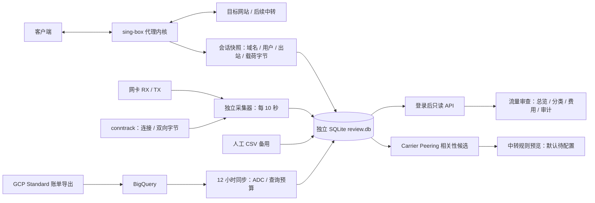

# VPS 部署：流量审查与 GCP 账单同步

适用：Ubuntu 22.04 / Debian 12 及以上，systemd；支持首次安装和已有面板升级。默认安装路径 `/usr/local/s-ui`、服务名 `s-ui`、面板以 root 运行。其他路径/服务用户先对应修改；非 root 面板与采集器应使用同一个 UID。不要运行上游一键安装器覆盖这个 fork。

## 从 GitHub 一键安装/升级

本仓库的 main 构建全部通过后会发布带 SHA256SUMS 的完整 Release。root 在 VPS 执行：

```bash
SUI_LANG=zhcn bash <(curl -fsSL https://raw.githubusercontent.com/JamesAlaHZS/s-ui-gpc-optimize/main/install.sh)
```

此命令从 **JamesAlaHZS/s-ui-gpc-optimize** 下载最新发布包；在 systemd 系统自动安装 conntrack、检测公网接口、启用内核连接记账、启动独立采集器并开启面板「流量审查」。原面板的交互配置流程保留，升级保留数据库。新安装也可在提示中修改端口、路径、管理员账号密码。非 systemd 系统仅安装原面板，采集器需手工配置。

后续运行 `s-ui` 打开管理菜单，其安装、升级和脚本更新地址均使用此 fork。真实 GCP 账单同步仍需第 5 节的项目 ID / 数据集 / IAM 配置，不会自动启用账单定时器。下面第 1～4 节仍可用于手工安装。

## 功能架构



三层字节不可相加。账单是项目/日期/SKU 汇总，不能证明具体网站被收费；Standard export 不能单独筛选某台 VM。五项统计以描述为主；200 GiB 仅是账户共享 Standard 免费线，本月已导入项目用量不能代表账户真实余量。中转建议不会自动写入路由。

## 1. 准备安装包并上传

优先使用本 fork 对应提交的 GitHub Actions `Release S-UI` 构建产物（`s-ui-linux-amd64` 或 `s-ui-linux-arm64`），解开外层下载 ZIP 后得到 `.tar.gz`。不要下载旧 Release 或上游 alireza0 的包；它们不一定含本功能。

若使用本次本地验证包：仅适用于 **x86_64、glibc >= 2.35**；采用 `test` profile，**不包含 Naive 出站**。使用 Naive 时改用 Actions 的完整 release 构建。包名 `s-ui-traffic-review-linux-amd64.tar.gz`，解包目录为 `s-ui`。上传前核对随包 SHA256SUMS。

本机 PowerShell（把 VPS_IP、包路径替换成实际值）：

```powershell
scp .\s-ui-traffic-review-linux-amd64.tar.gz root@VPS_IP:/root/
ssh root@VPS_IP
```

## 2. VPS 检查与备份

以下每个代码块按顺序在同一个 root Bash 中执行。已有面板先备份；首次安装会在启动前让你设置管理员账号密码。

```bash
sudo -i
set -euo pipefail
uname -m
getconf GNU_LIBC_VERSION
apt-get update
apt-get install -y conntrack sqlite3 iproute2 curl

install -d -m 0700 /root/s-ui-review-package
tar -xzf /root/s-ui-traffic-review-linux-amd64.tar.gz -C /root/s-ui-review-package
cd /root/s-ui-review-package/s-ui
./sui -v

if [ -x /usr/local/s-ui/sui ]; then
  systemctl show s-ui -p User -p ExecStart -p WorkingDirectory
  REVIEW_BACKUP="/root/s-ui-backup-$(date +%Y%m%d-%H%M%S)"
  install -d -m 0700 "$REVIEW_BACKUP"
  systemctl stop s-ui
  cp -a /usr/local/s-ui "$REVIEW_BACKUP/"
  systemctl cat s-ui >"$REVIEW_BACKUP/s-ui.service.txt"
  printf '%s\n' "$REVIEW_BACKUP" >/root/s-ui-last-review-backup
  systemctl start s-ui
  printf 'Backup: %s\n' "$REVIEW_BACKUP"
else
  install -d -m 0755 /usr/local/s-ui
  install -m 0755 ./sui /usr/local/s-ui/sui
  install -m 0644 ./s-ui.service /etc/systemd/system/s-ui.service
  read -r -p '管理员用户名: ' REVIEW_ADMIN_USER
  read -r -s -p '管理员密码（至少 12 位）: ' REVIEW_ADMIN_PASS
  printf '\n'
  test -n "$REVIEW_ADMIN_USER"
  test "${#REVIEW_ADMIN_PASS}" -ge 12
  /usr/local/s-ui/sui admin -username "$REVIEW_ADMIN_USER" -password "$REVIEW_ADMIN_PASS"
  unset REVIEW_ADMIN_PASS
  /usr/local/s-ui/sui setting -port 2095 -path /app/
fi
```

Actions 包名称可能不同，替换上述 `tar` 文件名即可。备份短暂停止服务，以免直接复制活跃 SQLite 得到不一致的面板备份。

## 3. 安装采集器

```bash
id sui-monitor >/dev/null 2>&1 || useradd --system --no-create-home --shell /usr/sbin/nologin sui-monitor
install -d -m 0700 -o sui-monitor -g sui-monitor /var/lib/s-ui-traffic-review
install -d -m 0750 -o root -g sui-monitor /etc/s-ui
install -m 0755 traffic-review /usr/local/bin/traffic-review
install -m 0640 -o root -g sui-monitor deploy/traffic-review-rules.example.json /etc/s-ui/traffic-review-rules.json
install -m 0644 deploy/traffic-review-collector.service /etc/systemd/system/

REVIEW_IFACE="$(ip -4 route show default | awk 'NR==1 {print $5}')"
test -n "$REVIEW_IFACE"
ip -br address show dev "$REVIEW_IFACE"
install -d /etc/systemd/system/traffic-review-collector.service.d
cat >/etc/systemd/system/traffic-review-collector.service.d/interface.conf <<EOF
[Service]
ExecStart=
ExecStart=/usr/local/bin/traffic-review collect --db /var/lib/s-ui-traffic-review/review.db --interface $REVIEW_IFACE --interval 10s --conntrack
EOF

# 记录旧值；新连接的逐连接字节需要开启内核记账。
modprobe nf_conntrack
if [ ! -e /root/nf_conntrack_acct.before-traffic-review ]; then
  cat /proc/sys/net/netfilter/nf_conntrack_acct >/root/nf_conntrack_acct.before-traffic-review
fi
printf 'net.netfilter.nf_conntrack_acct=1\n' >/etc/sysctl.d/90-s-ui-traffic-review.conf
sysctl -p /etc/sysctl.d/90-s-ui-traffic-review.conf

systemctl daemon-reload
systemctl enable --now traffic-review-collector
sleep 12
systemctl is-active traffic-review-collector
runuser -u sui-monitor -- /usr/local/bin/traffic-review health --db /var/lib/s-ui-traffic-review/review.db
```

健康输出应有 `enabled=true`、`available=true`、`conntrack.available=true`。检查失败时看本地 `/var/lib/s-ui-traffic-review/collector.err`。不要用普通 `sudo -u` 前台采集来验证 conntrack：它没有 unit 授予的 `CAP_NET_ADMIN`。开启记账只影响新连接，不要清空连接表。

## 4. 替换面板并开启页面

先确保采集器已运行并创建独立库。此步骤会短暂重启代理。

```bash
cd /root/s-ui-review-package/s-ui
install -d /etc/systemd/system/s-ui.service.d
cat >/etc/systemd/system/s-ui.service.d/traffic-review.conf <<'EOF'
[Unit]
Wants=traffic-review-collector.service
After=traffic-review-collector.service

[Service]
Environment="SUI_TRAFFIC_REVIEW_DB=/var/lib/s-ui-traffic-review/review.db"
EOF

systemctl stop s-ui
install -m 0755 ./sui /usr/local/s-ui/sui
systemctl daemon-reload
systemctl enable --now s-ui
systemctl is-active s-ui
/usr/local/s-ui/sui healthcheck
```

登录原面板，打开「流量审查」，等待 10–20 秒。未登录 API 返回 401；页面没有额外公网端口。示例 IP 分类仅是假设，部署命令默认不启用示例规则；确认自己的规则后再同时给面板和采集器配置 `--rules`/`SUI_TRAFFIC_REVIEW_RULES`。

首次安装先通过本机 SSH 隧道访问（本机新开终端执行 `ssh -L 12095:127.0.0.1:2095 root@VPS_IP`，浏览器打开 `http://127.0.0.1:12095/app/`）；公网面板使用另行配置的 HTTPS。新面板默认维护模式，还需在面板创建代理入口/用户并退出维护模式。本模块不创建代理协议或中转节点。

## 5. 配置 GCP 真实账单（可稍后启用）

先在 GCP 控制台完成：

1. Billing → Billing export → BigQuery export，启用 **Standard usage cost**，选择数据集。不要选 Detailed/FOCUS/Pricing。等待表 `gcp_billing_export_v1_...` 出现。
2. 查询项目启用 BigQuery API；给此 GCE VM 使用的服务账号授予查询项目 `roles/bigquery.jobUser`，给账单数据集授予 `roles/bigquery.dataViewer`。
3. VM OAuth access scope 包含 `cloud-platform` 或 BigQuery scope。仅授予 IAM 而 VM scope 不允许时，ADC 仍会返回 403；调整现有 VM scope 可能需要停机。

参考：[Standard export](https://docs.cloud.google.com/billing/docs/how-to/export-data-bigquery-tables/standard-usage)、[GCE 服务账号与 scope](https://docs.cloud.google.com/compute/docs/access/service-accounts)。不需要下载服务账号 JSON 私钥。

VPS 填入下面五个实际值（查询项目与数据集项目可相同；目标是 VM 所在项目）：

```bash
cat >/etc/s-ui/traffic-review-billing.env <<'EOF'
GCP_QUERY_PROJECT=your-query-project-id
GCP_DATASET_PROJECT=your-dataset-project-id
GCP_BILLING_DATASET=your_billing_dataset
GCP_BILLING_TABLE=gcp_billing_export_v1_XXXXXX_XXXXXX_XXXXXX
GCP_TARGET_PROJECT=your-vm-project-id
EOF
chown root:sui-monitor /etc/s-ui/traffic-review-billing.env
chmod 0640 /etc/s-ui/traffic-review-billing.env

set -a
. /etc/s-ui/traffic-review-billing.env
set +a
runuser -u sui-monitor -- /usr/local/bin/traffic-review sync-bill \
  --db /var/lib/s-ui-traffic-review/review.db \
  --query-project "$GCP_QUERY_PROJECT" --dataset-project "$GCP_DATASET_PROJECT" \
  --dataset "$GCP_BILLING_DATASET" --table "$GCP_BILLING_TABLE" \
  --target-project "$GCP_TARGET_PROJECT" --lookback-days 7 \
  --max-bytes 67108864 --max-monthly-bytes 4160749568 --adc --dry-run
```

只有返回 `status="dry_run_ok"` 才启用定时器：

```bash
cd /root/s-ui-review-package/s-ui
install -m 0644 deploy/traffic-review-bill-sync.service deploy/traffic-review-bill-sync.timer /etc/systemd/system/
systemctl daemon-reload
systemctl start traffic-review-bill-sync.service
systemctl enable --now traffic-review-bill-sync.timer
systemctl list-timers traffic-review-bill-sync.timer
```

同步失败查看 `/var/lib/s-ui-traffic-review/bill-sync.err`。定时器按 VPS 系统时区每天 00:15 / 12:15 加随机延迟运行，账单日期始终按洛杉矶划分。默认回看 7 天；首次要补本月历史，可在预算允许时单次使用 `--lookback-days 31`，不要自动提高查询上限。

预算只约束本库记录的本工具查询，单次最多 64 MiB、每月最多 3.875 GiB；查询超时/中断保留完整预算预留。存储检查只检查源账单表，不会限制表继续增长；不保证账户其他查询、存储和其他服务的总账单小于 $0.05。

不要把 `deploy/*example*` 样例导入生产库，否则虚构账单会参与汇总。若需演示，用另一个临时 `--db` 路径。

## 6. 日常分析与回滚

```bash
# 日期换成已产生本地采集和真实账单的同一个太平洋账单日
runuser -u sui-monitor -- /usr/local/bin/traffic-review analyze-candidates \
  --db /var/lib/s-ui-traffic-review/review.db \
  --date 2026-10-18 --timezone America/Los_Angeles
```

中转默认待配置。确定中转出站后加 `--relay-outbound 实际出站Tag` 只生成预览；需另行核验、手工应用。无账单的前后对比会拒绝计算，不会把缺失数据当成费用下降。

回滚面板二进制（保留独立采集库）：

```bash
REVIEW_BACKUP="$(cat /root/s-ui-last-review-backup)"
test -x "$REVIEW_BACKUP/s-ui/sui"
systemctl stop s-ui
install -m 0755 "$REVIEW_BACKUP/s-ui/sui" /usr/local/s-ui/sui
rm -f /etc/systemd/system/s-ui.service.d/traffic-review.conf
systemctl daemon-reload
systemctl start s-ui
# 如需连同采集、同步一起停用：
systemctl disable --now traffic-review-bill-sync.timer traffic-review-collector.service
rm -f /etc/sysctl.d/90-s-ui-traffic-review.conf
sysctl -w "net.netfilter.nf_conntrack_acct=$(cat /root/nf_conntrack_acct.before-traffic-review)"
```

只在确认没有后续面板配置变更时才恢复整份面板数据库。生产连续观察 48–72 小时和真实 Google 账单核对需在部署后完成。
